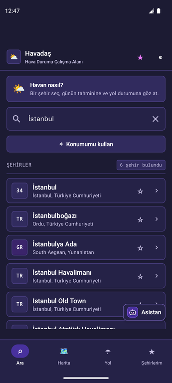
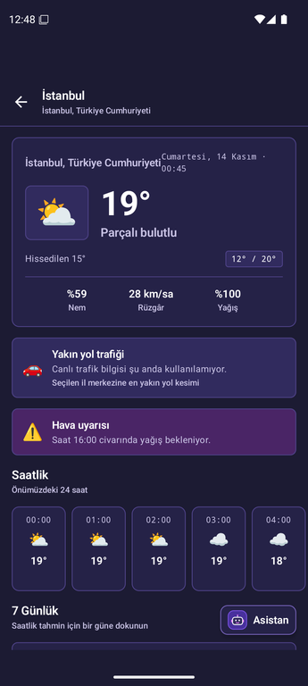
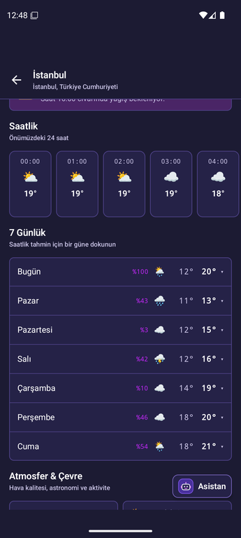
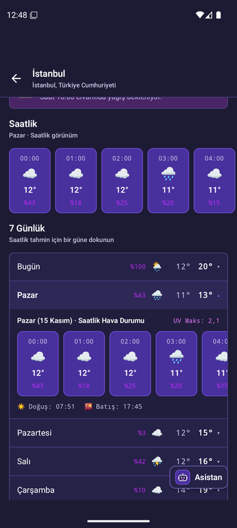
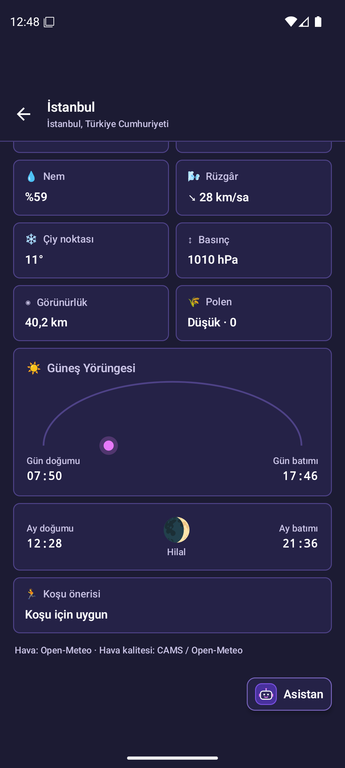
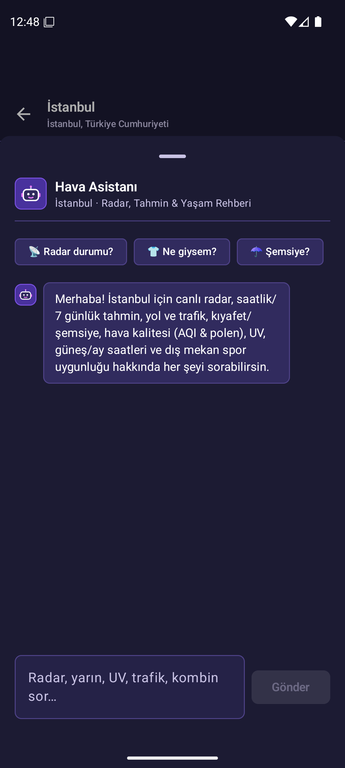
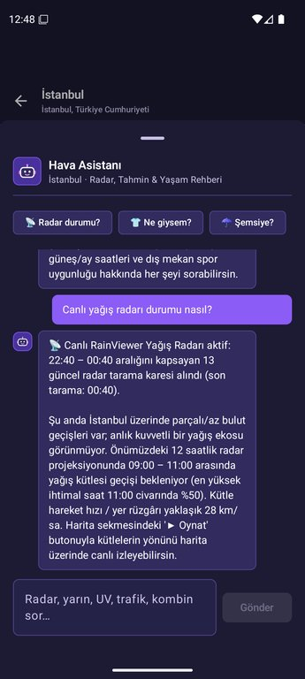
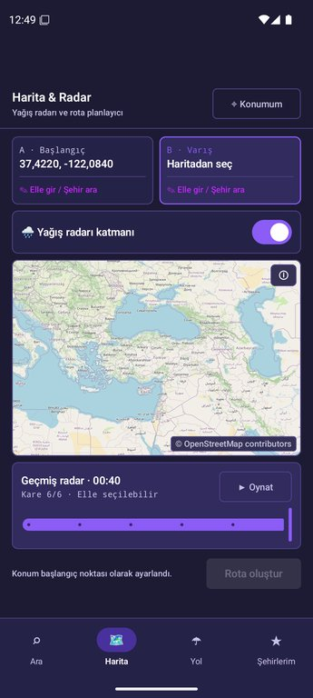
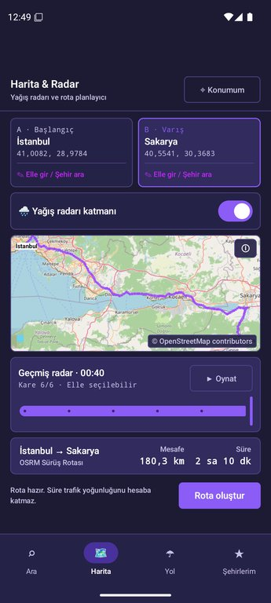
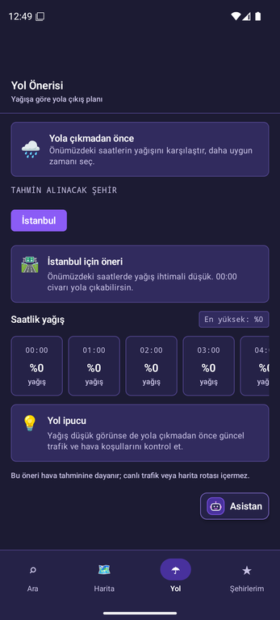

# Havadaş

**Bugün gökyüzünde ne var?**

Havadaş, şehirlerin güncel hava durumunu, tıklanabilir 7 günlük/saatlik tahminlerini, canlı yağış radarını, Türkiye yol haritası üzerinde OSRM rota hesabını ve yağışa dayalı yola çıkış önerilerini **Midnight Violet** minimalist bir arayüzde sunan Android uygulamasıdır. Uygulama içi **Hava Asistanı**, seçili şehrin tahminine ve canlı **RainViewer** radar taramalarına dayanarak radar kütle hareketleri, canlı trafik, yarın/hafta sonu durumu, saatlik tahmin, hava kalitesi (AQI/polen), UV endeksi, astronomi, spor uygunluğu, şemsiye ve kıyafet sorularına yanıt verir.

Uygulama Kotlin, Jetpack Compose ve Material 3 ile geliştirilmiştir. Hava, şehir ve hava kalitesi verileri API anahtarı gerektirmeyen Open-Meteo servislerinden; yağış radarı karoları ise RainViewer servisinden alınır.

## Eğitim kaynağı ve proje ilişkisi

Havadaş, [Bilişim Kampı Android eğitimindeki hava durumu referans projesinden](https://github.com/tc-yusufburakdemir/weather-app) yola çıkar. Kaynak depoda şehir arama, tahmin ekranı ve üç katmanlı mimari adım adım gösterilir. Bu depoda ise bu temel; **Midnight Violet minimalist arayüz**, **favori şehirler**, **etkileşimli 7 günlük/saatlik tahmin tablosu**, **Türkiye haritası & canlı yağış radarı**, **OSRM rota hesaplama**, **yol önerisi** ve **radar/trafik destekli Hava Asistanı** ile genişletilmiştir. Mimari notları için [docs/ARCHITECTURE.md](docs/ARCHITECTURE.md) dosyasına bakabilirsin.

## Uygulamaya bakış (Ekran Görüntüleri)

### 1. Şehir Arama, Hava Tahmini ve Tıklanabilir 7 Günlük / Saatlik Görünüm

| Şehir Arama | Detaylı Hava Tahmini | 7 Günlük Tablo | 7 Günlük Saatlik Detay | Atmosfer, Güneş & Ay |
| :---: | :---: | :---: | :---: | :---: |
|  |  |  |  |  |

### 2. Hava Asistanı, Canlı Yağış Radarı, OSRM Rota ve Yol Önerisi

| Hava Asistanı | Canlı Radar Analizi | Harita & Yağış Radarı | OSRM Sürüş Rotası | Yol Önerisi |
| :---: | :---: | :---: | :---: | :---: |
|  |  |  |  |  |

## Özellikler

- **Midnight Violet Minimalist Arayüz:** İnce `1.dp` çerçeveli kartlar, yüksek kontrastlı tipografi ve göz yormayan gece moru/laciverti (`#1C1B33` / `#252247` / `#48319D` / `#8B5CF6` / `#C427FB`) renk paleti; üst bardaki `◐` butonu ile standart **Violet** ve **Deep Midnight Violet** tonları arasında anında geçiş
- **Şehir Arama & GPS Konum:** Şehir adıyla anlık arama (350 ms debounce ile), plaka/ülke kodu rozetleri ve konum izniyle bulunduğun yerin hava tahminini tek dokunuşla açma
- **Tıklanabilir 7 Günlük Tablo & Saatlik Detay:** 7 günlük tablodaki herhangi bir güne (`Bugün`, `Cumartesi`, `Pazar` vb.) dokunulduğunda o güne ait 24 saatlik hava durumu kapsüllerinin (`00:00` – `23:00`), gün doğumu/batımı saatlerinin ve maksimum UV bilgisinin akordeon animasyonuyla açılması
- **Harita, OSRM Rota & Canlı Yağış Radarı:**
  - Türkiye il sınırları katmanı ile OpenStreetMap haritası üzerinde dokunarak, mevcut konumu kullanarak veya şehir/koordinat arayarak başlangıç ve varış noktası seçme
  - OSRM yönlendirme servisiyle iki nokta arasındaki rotayı mor (`#9D50FF`) çizgiyle haritada gösterme, toplam mesafe (`km`) ve tahmini sürüş süresini hesaplama
  - **RainViewer** geçmiş radar karelerini harita üzerinde katman olarak görüntüleme ve zaman çizelgesi oynatıcısıyla (`▶ Oynat`) yağış kütlelerinin hareketini izleme
- **Atmosfer & Çevre Panosu:**
  - Anlık sıcaklık, hissedilen sıcaklık, bağıl nem, rüzgâr hızı, yüzey basıncı (`hPa`), çiy noktası ve görüş mesafesi (`km`)
  - Avrupa Hava Kalitesi Endeksi (**AQI**), **UV endeksi**, bölgesel **polen** seviyesi ve bunlara dayalı **dış mekan koşu önerisi**
  - Kanvas çizimli **Güneş Yörüngesi** (gün doğumu/batımı) ve **Ay Evresi** (ay doğumu/batımı) kartları
- **Yol Önerisi:** Favori şehirler veya hızlı seçilen şehirler için önümüzdeki 6 saatin yağış olasılıklarını karşılaştırarak yola çıkmak için en uygun saati önerme
- **Gelişmiş Hava Asistanı (Canlı Radar & Trafik Destekli):**
  - Özel vektör logolu (`ic_weather_assistant.xml`) sohbet penceresi ve tek dokunuşluk hızlı soru çipleri
  - **Canlı Yağış Radarı Sorgusu:** *"Radar durumu nasıl?"* sorulduğunda RainViewer API'sinden son radar tarama saatlerini, kare sayısını ve şehir üzerindeki 12 saatlik yağış kütle projeksiyonunu canlı analiz etme
  - **Canlı Trafik & Yol Güvenliği:** TomTom Traffic Flow Segment API ile seçili şehir merkezine en yakın yol kesimindeki anlık hızı, serbest akış hızını ve gecikmeyi hava kaynaklı yol riskleriyle birlikte özetleme
  - **Geniş Soru Desteği:** Yarınki tahmin, hafta sonu durumu, haftanın belirli bir günü (*"Pazartesi nasıl?"*), 7 günlük en sıcak/soğuk gün özeti, sabah/öğle/akşam/gece saatlik görünümü, AQI/polen alerji durumu, UV koruma, gün doğumu/batımı, spor/koşu için en ideal saat, kıyafet/kombin ve şemsiye önerileri

> Rota, seçilen iki koordinat arasında OSRM demo servisiyle hesaplanır; gösterilen süre canlı trafik yoğunluğunu hesaba katmaz. Yağış radarı RainViewer'ın kişisel/eğitim amaçlı, anahtarsız radar görüntülerini kullanır. Harita ve radar verisi atıfları için [docs/MAP-DATA.md](docs/MAP-DATA.md) dosyasına bak.

## Teknolojiler

- **Dil & Çalışma Zamanı:** Kotlin 2.2.20 ve Java 17
- **Arayüz:** Jetpack Compose, Material 3, Navigation Compose ve özel `Canvas` / Vector Drawable bileşenleri
- **Durum Yönetimi & Eşzamanlılık:** ViewModel, `StateFlow`, `rememberSaveable` ve Kotlin Coroutines
- **Ağ & Serileştirme:** Retrofit, Gson ve OkHttp
- **Veri Servisleri:**
  - Open-Meteo Geocoding, Forecast ve Air Quality (CAMS) API'leri (API anahtarı gerekmez)
  - RainViewer Weather Maps API (`public/weather-maps.json` — canlı radar kareleri; anahtar gerekmez)
  - OSRM Routing API (`router.project-osrm.org` — rota geometrisi, mesafe ve süre)
  - TomTom Traffic Flow Segment API (`local.properties` içinde `TOMTOM_API_KEY` ile canlı trafik akışı)
- **Harita:** `osmdroid` ile OpenStreetMap ve Türkiye il sınırları GeoJSON katmanı
- **Test:** JUnit 4, Coroutines Test ve MockWebServer ile birim testleri

## Nasıl çalışır?

Arayüz, veri alma ve ekran durumu birbirinden ayrıdır:

```text
Compose Ekranı → ViewModel (StateFlow) → Repository → Retrofit → Open-Meteo / RainViewer / TomTom / OSRM
```

- `ui/` kullanıcı arayüzünü (`city`, `forecast`, `map`, `route`, `component`, `theme`),
- `model/` şehir, tahmin ve hava durumu modellerini,
- `data/` ise API istemcilerini, repository sınıflarını ve favori şehirlerin yerel kaydını içerir.

ViewModel'ler `LoadState` (`Loading`, `Success`, `Empty`, `Error`) durumlarını üretir; Compose ekranları bu duruma göre görünümü günceller.

## Kullanılan API uç noktaları

| Amaç | İstek örneği |
|---|---|
| Şehir arama | `https://geocoding-api.open-meteo.com/v1/search?name=Ankara&count=10&language=tr` |
| Hava tahmini (7 gün + saatlik) | `https://api.open-meteo.com/v1/forecast?latitude=39.92&longitude=32.85&current=...&hourly=...&daily=...&forecast_days=7&timezone=auto` |
| Hava kalitesi & polen | `https://air-quality-api.open-meteo.com/v1/air-quality?latitude=39.92&longitude=32.85&current=european_aqi,uv_index,grass_pollen,...&timezone=auto` |
| Canlı yağış radarı | `https://api.rainviewer.com/public/weather-maps.json` |
| OSRM rota hesabı | `https://router.project-osrm.org/route/v1/driving/{startLon},{startLat};{destLon},{destLat}?overview=full&geometries=geojson` |
| Canlı trafik akışı | `https://api.tomtom.com/traffic/services/4/flowSegmentData/absolute/10/json?point={lat},{lon}&key={TOMTOM_API_KEY}` |

## Gereksinimler ve çalıştırma

- Android Studio
- JDK 17
- Android SDK 36
- Android 8.0 (API 26) veya üzeri bir cihaz/emülatör

Canlı trafik için TomTom Developer hesabından Traffic API anahtarı alıp mevcut `local.properties` dosyasına `TOMTOM_API_KEY=anahtarınız` satırını ekleyebilirsin (`local.properties.example` dosyasına bak). Anahtar tanımlanmasa bile uygulamanın hava tahmini, radar, harita ve rota özellikleri eksiksiz çalışır.

Windows PowerShell'de derleme ve test:

```powershell
.\gradlew.bat assembleDebug
.\gradlew.bat testDebugUnitTest
```

macOS veya Linux'ta:

```bash
./gradlew assembleDebug
./gradlew testDebugUnitTest
```

Debug APK, `app/build/outputs/apk/debug/app-debug.apk` altında oluşturulur.

## Sürüm bilgisi

| Alan | Değer |
|---|---|
| Uygulama sürümü | `1.0.0` |
| Android sürüm kodu | `2` |
| Minimum Android | API 26 (Android 8.0) |
| Hedef Android API | 36 |

## Proje yapısı

```text
app/src/main/java/com/kampplus/hava/
├── data/       Open-Meteo, RainViewer, OSRM, TomTom API istemcileri, repository'ler ve favori kaydı
├── model/      City, Forecast, CurrentWeather, HourlyForecast, DailyForecast, AirQuality ve WeatherCondition modelleri
└── ui/
    ├── city/      Şehir arama, GPS konum sağlayıcı ve favoriler ekranı
    ├── forecast/  Detaylı tahmin ekranı, tıklanabilir 7 günlük/saatlik tablo ve atmosfer panosu
    ├── map/       Türkiye haritası, OSRM rota çizimi ve RainViewer canlı yağış radarı
    ├── route/     Yağış olasılığına dayalı yol önerisi ekranı
    ├── component/ Paylaşılan bileşenler ve canlı radar/trafik destekli Hava Asistanı
    └── theme/     Midnight Violet & Deep Violet renk paleti, tema ve tipografi
```

## Testler

`app/src/test/` altındaki birim testleri model, API ve ekran durumlarını doğrular:

| Test | Kapsadığı davranış |
|---|---|
| `WeatherConditionTest` | WMO kodlarının Türkçe hava durumu ve simgelere eşlenmesi |
| `CityApiTest` | Şehir yanıtı alanlarının Gson ile doğru okunması |
| `ForecastApiTest` | Tahmin yanıtındaki sütunların saatlik/günlük modellere dönüştürülmesi |
| `CityViewModelTest` | Arama, `Loading`/`Success`/`Empty`/`Error` durumları ve tekrar deneme |
| `ForecastViewModelTest` | Navigasyon parametreleri, tahmin yükleme ve hata durumları |

## Release imzası

Release derlemesini kendi anahtarınla imzalamak için `keystore.properties.example` dosyasını `keystore.properties` adıyla kopyalayıp kendi imza bilgilerinle doldur. Release APK oluşturmak için Windows'ta `.\gradlew.bat assembleRelease`, macOS/Linux'ta `./gradlew assembleRelease` komutunu kullanabilirsin.
