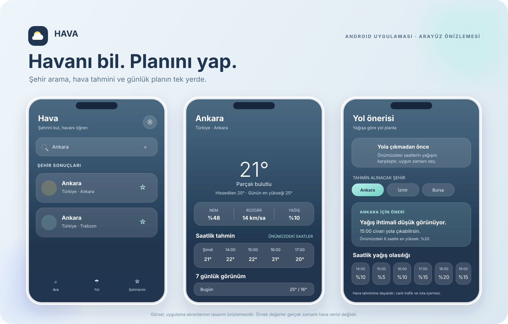

# Hava

Hava, şehirlerin güncel hava durumunu ve tahminlerini gösteren bir Android uygulamasıdır. Şehir arayabilir, bir şehri favorilerine ekleyebilir ve yağış olasılığına göre önümüzdeki saatler için yol önerisi alabilirsin. Hava Asistanı da seçili şehrin tahminine göre sıcaklık, yağış, şemsiye ve kıyafet sorularına uygulama içinde yanıt verir.

Uygulama Kotlin ve Jetpack Compose ile geliştirilmiştir. Hava ve şehir verileri, API anahtarı gerektirmeyen Open-Meteo servislerinden alınır.

## Uygulamaya bakış



*Bu görsel uygulama arayüzünün önizlemesidir; içindeki hava durumu değerleri örnektir, canlı ekran görüntüsü değildir.*

## Özellikler

- Şehir adıyla arama ve arama sonucundan şehir seçme
- Anlık sıcaklık, hissedilen sıcaklık, nem, rüzgâr ve hava durumu bilgisi
- Saatlik ve 7 günlük hava tahmini
- Şehirleri favorilere kaydetme; kayıtlar cihazda saklanır
- Favori şehirler için önümüzdeki saatlerin yağış olasılığına dayalı yol önerisi
- Hava Asistanı ile hava tahminine dayalı sorulara uygulama içi yanıtlar
- Yükleniyor, sonuç yok, veri ve hata durumları için ayrı ekranlar

> Yol önerileri hava tahminine dayanır; uygulama canlı trafik veya harita rotası sağlamaz. Hava Asistanı uygulama içinde tahmin verisini kurallarla yorumlar; çevrimiçi bir yapay zekâ servisine bağlanmaz.

## Teknolojiler

- Kotlin 2.2.20 ve Java 17
- Jetpack Compose, Material 3 ve Navigation Compose
- ViewModel, StateFlow ve Kotlin Coroutines
- Retrofit, Gson ve OkHttp
- Open-Meteo Geocoding API ve Forecast API
- JUnit ve MockWebServer ile birim testleri

## Nasıl çalışır?

Arayüz, veri alma ve ekran durumu birbirinden ayrıdır:

```text
Compose ekranı → ViewModel (StateFlow) → Repository → Retrofit → Open-Meteo
```

`ui/` kullanıcı arayüzünü, `model/` şehir ve tahmin modellerini, `data/` ise API bağlantısını ve favori şehirlerin yerel kaydını içerir. ViewModel'ler yükleniyor, başarılı, boş ve hata durumlarını üretir; Compose ekranları bu duruma göre görünümü günceller.

## Gereksinimler ve çalıştırma

- Android Studio
- JDK 17
- Android SDK 36
- Android 8.0 (API 26) veya üzeri bir cihaz/emülatör

Projeyi Android Studio'da açıp Gradle eşitlemesinin tamamlanmasını bekleyebilirsin. Komut satırından Windows'ta:

```powershell
.\gradlew.bat assembleDebug
.\gradlew.bat testDebugUnitTest
```

macOS veya Linux'ta:

```bash
./gradlew assembleDebug
./gradlew testDebugUnitTest
```

Debug APK, `app/build/outputs/apk/debug/` altında oluşturulur. Android SDK yolu bulunamazsa `local.properties` dosyasındaki `sdk.dir` değerini veya `ANDROID_HOME` ortam değişkenini ayarla. `local.properties` kişisel makine ayarıdır ve depoya eklenmez.

## Sürüm bilgisi

| Alan | Değer |
|---|---|
| Uygulama sürümü | 1.0.0 |
| Android sürüm kodu | 2 |
| Minimum Android | API 26 (Android 8.0) |
| Hedef Android API | 36 |

Sürüm değerleri `app/build.gradle.kts` içinde tanımlıdır.

## Proje yapısı

```text
app/src/main/java/com/kampplus/hava/
├── data/       Open-Meteo istemcileri, repository'ler ve favori kaydı
├── model/      Şehir, tahmin ve hava durumu modelleri
└── ui/
    ├── city/      Şehir arama ve favoriler
    ├── forecast/  Hava durumu ve tahmin ekranı
    ├── route/     Yağışa dayalı yol önerisi
    ├── component/ Paylaşılan bileşenler ve Hava Asistanı
    └── theme/     Compose tema ve tipografi
```

## Testler

`app/src/test/` altındaki birim testleri hava durumu kodlarının eşleşmesini, API yanıtlarının çözülmesini, tahmin verisinin dönüştürülmesini ve şehir/tahmin ViewModel durumlarını kapsar.

## Release imzası

Release derlemesini kendi anahtarınla imzalamak için `keystore.properties.example` dosyasını `keystore.properties` adıyla kopyalayıp kendi imza bilgilerinle doldur. Gerçek imza dosyaları ve anahtarlar depoya eklenmemelidir. Bu dosya yoksa release derlemesi debug anahtarını kullanır; mağazada yayımlamak için kendi release anahtarın gerekir.
